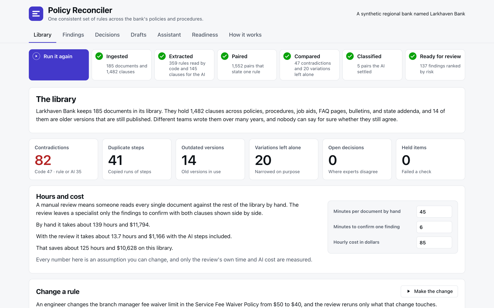
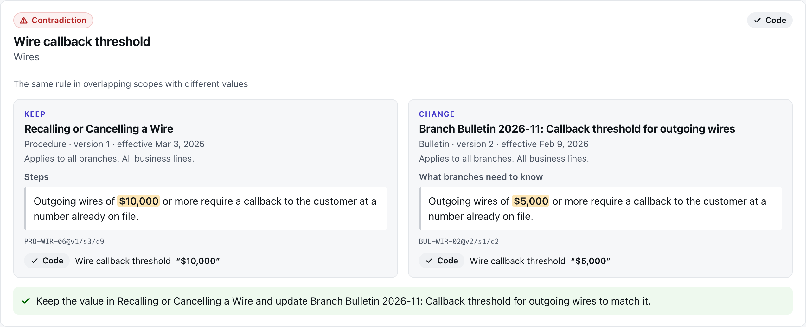
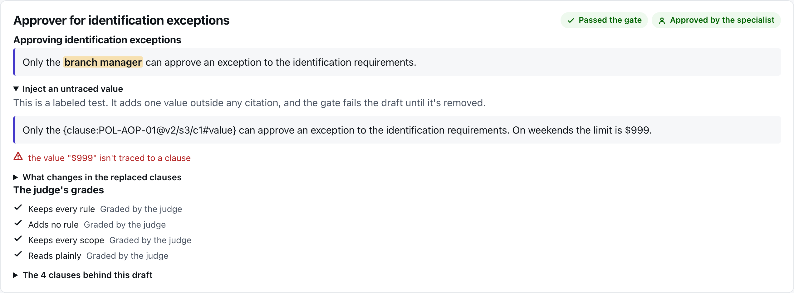
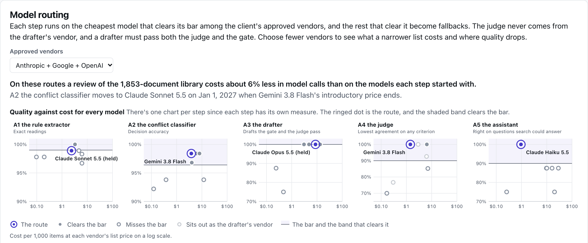

# Policy Reconciler

**[Open the live demo](https://www.ryansansbury.com/policy-reconciler/)** and press Run the review. It runs in your browser, and there's nothing to install.

A bank's policies, procedures, job aids, FAQ pages, and bulletins are written by different teams over years, and nobody can say for sure whether they still agree. Policy Reconciler reads the whole library and finds the rules that contradict each other, the steps copied between documents, and the older versions still published, and it leaves alone the rules that differ on purpose. Code makes every decision it can, five AI steps handle only what code can't read for certain, and a person settles what the evidence can't and approves every change before it publishes.

Every bank, person, policy, and number here is synthetic. Every AI result on the page was recorded once and replays on each build after code checks it again, and that means the demo makes no model calls, needs no keys, and costs nothing to run.

## Open it

The live demo is at https://www.ryansansbury.com/policy-reconciler/, and it's the same page this repo builds. To build it yourself run `python3 build.py` from this folder and open `site/index.html` in a browser. The first build generates the synthetic world and takes under ten seconds on a recent laptop, and later builds take a few seconds. The page works straight from the file system, and nothing on it reaches the network. The project needs only Python's standard library and has been tested on Python 3.15.

## What's on the page

The Library tab shows the bank's 185 documents before the review, Run the review fills in each stage from reading the files to the ranked findings, and Change a rule shows one edit rerunning only what it touches. Findings ranks every finding by risk with the weights open to change, and each one shows both clauses side by side with the rule that decided it. Decisions holds the four places the two synthetic experts disagreed and the written decision for each, Drafts shows each consolidated rule with the gate's check and the judge's grades, and Assistant compares an employee's answers before and after reconciliation. Readiness is a report code writes from the results with no AI prose, and How it works covers the architecture, the AI map, model routing, the embeddings experiment, cost at scale, the production kit, links to the six files that matter most, and the known limits.

## Results

Every number in this table is read from a results file, and none is typed in. Each held-out library was scored once after the code and prompts it measures were frozen. The two rows on the newer libraries came from a round with Claude Sonnet on both AI steps before routing moved the classifier to Gemini 3.8 Flash.

| What ran | Planted problems caught | False alarms |
|---|---|---|
| Code alone on three held-out libraries | 262 of 270 | 0 of 120 |
| Code alone on three new held-out libraries | 265 of 267 | 0 |
| Code with the AI steps on the same three libraries | 266 of 267 | 0 |

## Where it's deterministic, probabilistic, and human

| Step | Done by | Type | How it's kept honest |
|---|---|---|---|
| Parse documents into sections and clauses with stable IDs | Code | Deterministic | Byte-identical rebuilds and a fingerprint for every library |
| Read clear values like dollar amounts, times, deadlines, percentages, counts, roles, and must or may | Code | Deterministic | Unit tests on every pattern |
| Read rules from free text into a fixed form | AI step A1 | Probabilistic | Every value quoted from the clause, roles from a fixed list, inferred fields flagged, and one repair |
| Find the statements of the same rule | Code | Deterministic | The rule vocabulary within each topic was tuned on development seeds and scored on held-out seeds |
| Compare values on the same rule | Code | Deterministic | Exact and explainable with unit tests |
| Apply scope and dates | Code | Deterministic | A deliberate variation with a stated scope is never flagged |
| Judge what code can't settle | AI step A2 | Probabilistic | A label from a fixed list, both clauses quoted, and scored against the frozen key |
| Apply precedence | Code | Deterministic | The rules come from the decision records |
| Spot where the experts disagree | Code | Deterministic | Label comparison and Cohen's kappa |
| Settle a disagreement | People | Human | A decision record that becomes a rule and a test |
| Draft the consolidated section | AI step A3 | Probabilistic | Values only through citations, a gate for untraced values, a diff by code, and a specialist's approval |
| Grade drafts at scale | AI step A4 | Probabilistic | Calibrated against the experts by criterion and never from the drafter's family |
| Answer employees' questions | AI step A5 | Probabilistic | Every value in a cited clause and conflicting sources flagged |
| Choose each AI step's model | Code | Deterministic | The cheapest model that clears the step's bar within the approved vendors |
| Mask account numbers and identifiers before any model call | Code | Deterministic | A test that no recorded prompt holds an unmasked pattern |
| Publish approved changes to the assistant's index | Code | Deterministic | Lineage from each change to its finding and its approver |

## The rules the code holds to

- AI runs only where code can't decide, and the AI never sees what code can settle.
- Every AI output is checked by code against its clause, a fixed vocabulary, and quoted spans, and a failed check gets one repair request and then a hold with the reasons.
- People's decisions are versioned and become rules and tests.
- The judge is calibrated against the experts and never comes from the drafter's model family.
- Customer details were masked before every recorded model call, and every call has a line in the audit log.
- The page replays recorded runs and validates each one again, and it carries no source because the code lives here.

## Testing

`python3 -m tests.run` runs the whole suite, and `python3 ci/run_gate.py` runs the gate that CI runs with the tests, the build and its strip check, the key scan, and the regression thresholds. Build once before testing because the tests that need the generated world skip until it exists. The page test also clicks through the built page in Node when Node is installed.

## Structure

| Folder | What it holds |
|---|---|
| `generate/` | The synthetic bank, its library, the planted problems, the answer key, and the evaluation sets |
| `engine/` | The code-only review, the gate, the diff, search, the publisher, and incremental runs |
| `agents/` | The AI steps' inputs, masking, validation, replay, routing, and the combined review |
| `prompts/` | One prompt for each of the five AI steps |
| `data/ai_runs/` | Every recorded AI result and the audit log that the build replays and checks |
| `evals/` | Scoring, the freezes, agreement, and every results file |
| `config/` | The models and their prices, routing, risk weights, readiness thresholds, the gate's bars, and the page's address |
| `app/` | The page's view model, renderer, script, and styles |
| `tests/` | The test suite and a click-through of the built page |
| `ci/` | The gate that `.github/workflows/gate.yml` runs on every push and pull request |
| `docs/` | The design Q&A, the build guide, the decision records, and the screenshots in this README |

## Limitations

- Scanned PDFs and tables inside PDFs aren't read. The parser reads Word, web pages, and Markdown.
- Three planted problems span several clauses, and in each one three rules together leave no one able to act. Pairwise comparison can't see them.
- Code can't read every policy statement. When it misses one a weaker document can become the authority until the rule extractor reads the clause.
- The held-out libraries use the same phrasing families as the development ones. The hand-written clauses test new wording, and code alone reads few of them.
- Masking uses patterns. A production deployment would add a dedicated detector for names and addresses.
- The judge's calibration drafts carry clear-cut planted defects. On the 34 real drafts Gemini 3.1 Pro flagged five the specialist had approved, and the routed judge flagged none. The specialist ruled three harmless, one a gap in the source policy, and one real. That's why a person still approves every single draft.
- Keyword search often misses a question's clause before reconciliation. Embeddings found some and lost others, and a ten-clause hybrid is next.
- The model comparison runs each model on one library's 180 extraction clauses and a subset of 69 pairs, 8 drafts, 30 calibration drafts, and 10 questions. On the assistant a single answer separates the route from the rest. The candidates were fixed on 10/28, and a newer model such as Gemini 4 Argon joins with one owner run.
- Every model is priced at list price without the prompt caching a deployment would add, and each model's thinking counts as output the way its vendor bills it.
- A model's result on the same clauses can move between runs by more than the extraction bar. Close routes need repeated runs or a person's hold.
- An extractor that reads a conditional approval as a general rule can make the wrong clause a rule's authority. Approval caught it on the demo.
- Every bank, person, policy, and number here is synthetic.

## License

The code is under the [PolyForm Noncommercial License 1.0.0](LICENSE), and the docs, the screenshots, and the synthetic data are under [Creative Commons Attribution-NonCommercial 4.0](https://creativecommons.org/licenses/by-nc/4.0/). You're welcome to read it, run it, and change it for personal, educational, research, or other noncommercial use, and commercial use isn't permitted.
